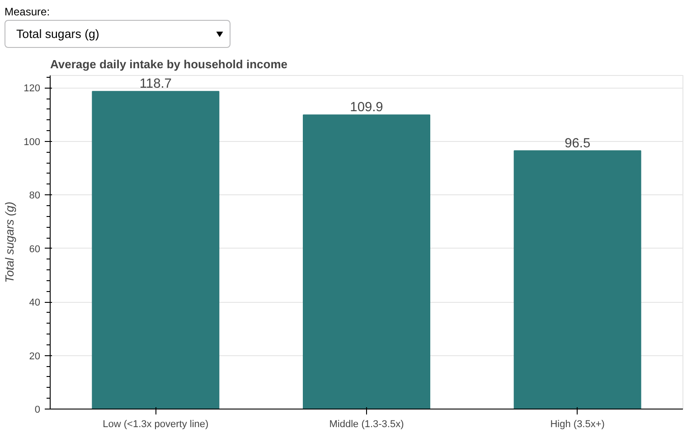

# Data Analysis Projects

A collection of data analysis projects using Python, SQL and visualisation tools. Each folder is a self-contained project with its own README, notebook, data and charts.

## Projects

| Project | What it answers | Tools |
|---|---|---|
| [YouTube COVID-19 News Engagement](youtube-news-analysis/) | How did audience engagement with COVID-19 news differ across BBC, CNN, Fox News and MSNBC on YouTube? | Python, pandas, seaborn, YouTube Data API |
| [Diet, Income & BMI in US Adults](diet-income-health-analysis/) | How does diet differ by gender, income and education in US adults, and does calorie intake track with BMI? | Python, pandas, Bokeh, NHANES (CDC) |
| [What Do Gardeners Ask?](gardening-qa-analysis/) | What does an online gardening community ask, when, and has it kept up with answering? | Python, pandas, regex, Bokeh |

## Highlights

**YouTube COVID-19 News Engagement:** Fox News had the most engaged audience, at 1.59 likes per 100 views (about double BBC and CNN), while CNN led on reach with 47% of all views.

**Diet, Income & BMI in US Adults:** Income changes diet quality, not quantity: higher-income adults eat 19% less sugar and 12% more fibre on the same ~2,150 calories, while reported calories show no link to BMI (ρ = 0.00).

**What Do Gardeners Ask?:** The share of questions answered fell from 99% (2011) to 63% (2023), and the top 1% of answerers wrote 61% of all answers, so the community depends on a few experts.

## Running a project

    cd <project-folder>
    pip install -r requirements.txt
    jupyter notebook