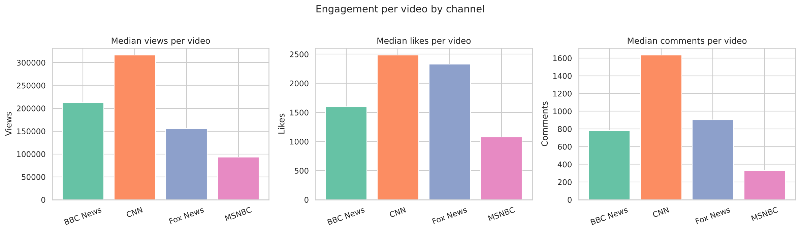

# Data Analysis Projects

A collection of data analysis projects using Python, SQL and visualisation tools. Each folder is a self-contained project with its own README, notebook, data and charts.

## Projects

| Project | What it answers | Tools |
|---|---|---|
| [YouTube COVID-19 News Engagement](youtube-news-analysis/) | How did audience engagement with COVID-19 news differ across BBC, CNN, Fox News and MSNBC on YouTube? | Python, pandas, seaborn, YouTube Data API |

## Highlights

**YouTube COVID-19 News Engagement:** Fox News had the most engaged audience, at 1.59 likes per 100 views (about double BBC and CNN), while CNN led on reach with 47% of all views.

## Running a project

    cd <project-folder>
    pip install -r requirements.txt
    jupyter notebook

