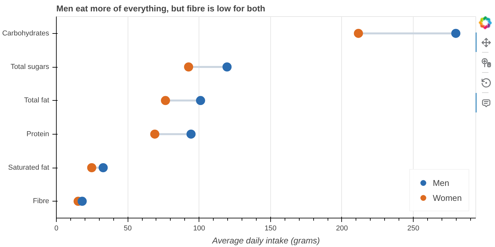
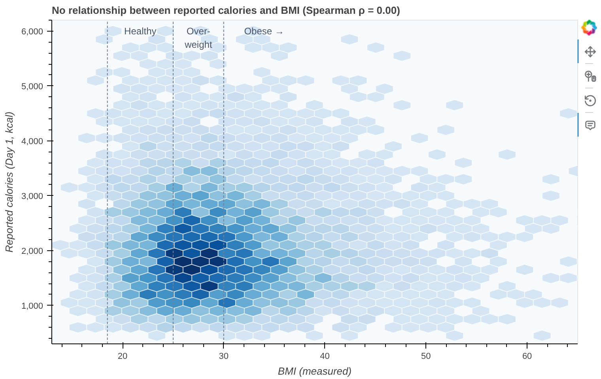
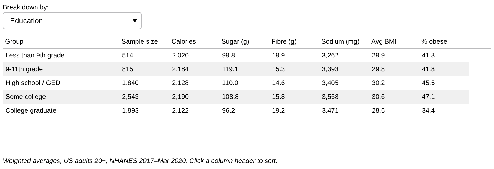
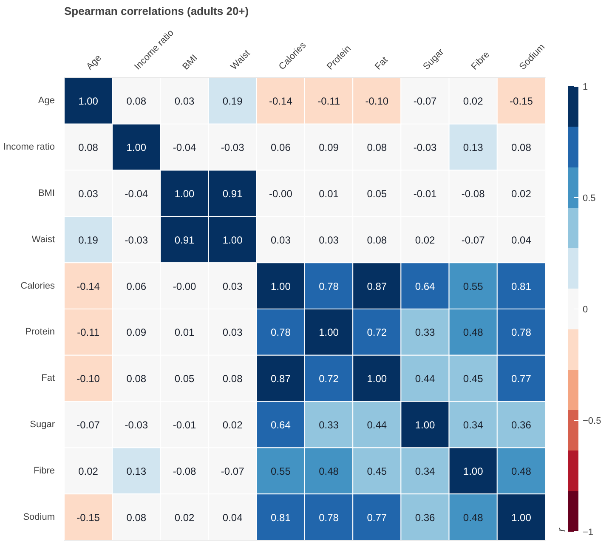

# Diet, Income & BMI in US Adults (NHANES 2017–2020)

How does what US adults eat differ by gender, income and education, and does daily calorie intake actually track with body weight? This project merges four CDC health-survey files (**7,613 adults**) and uses population-weighted analysis and interactive Bokeh charts to find out.

**Tools:** Python · pandas · Bokeh (interactive charts) · Jupyter

📓 **[View the full notebook with interactive charts (nbviewer)](https://nbviewer.org/github/tinak25/data-analysis-projects/blob/main/diet-income-health-analysis/diet_income_health_analysis.ipynb)**

## Key findings

| | Finding |
|---|---|
| ⚖️ | **42% of US adults are obese** and 32% overweight. This matches the CDC's published 41.9%, which validates the data pipeline. |
| 🍽️ | Men report **36% more calories** than women (2,484 vs 1,832 kcal), but both average only **15–18 g of fibre**, well below the ~25–35 g recommended for their calorie intake. |
| 📉 | **Reported calories don't predict BMI** (Spearman ρ = 0.00). That's largely a measurement story: under-reporting rises with BMI, and one day's intake only correlates 0.44 with the same person's next day. |
| 💰 | **Income changes diet quality, not quantity:** high-income adults eat **19% less sugar** and **12% more fibre** than low-income adults, on the same ~2,150 kcal. |
| 🎓 | **College graduates** have the lowest sugar intake and a **34% obesity rate**, vs 45–47% for adults with a high-school diploma or some college. |

## Charts

**Nutrient intake by gender**


**BMI vs reported calories**: 7,481 adults in a hexbin density plot


**Diet by household income**: in the notebook, a dropdown switches between sugar, fibre, calories, saturated fat, sodium and BMI


**Demographic group explorer**: in the notebook, a dropdown breaks results down by gender, age, income, education or ethnicity


**Correlation heatmap**: body-size and diet-amount measures form two separate clusters


## Data & method

| File | Contents |
|---|---|
| `P_DEMO` | Demographics: age, gender, ethnicity, education, income-to-poverty ratio |
| `P_DR1TOT` / `P_DR2TOT` | 24-hour dietary recall, Day 1 and Day 2 total nutrients |
| `P_BMX` | Body measures: measured BMI and waist circumference |

Source: [CDC NHANES 2017–March 2020 pre-pandemic](https://wwwn.cdc.gov/nchs/nhanes/continuousnhanes/default.aspx?Cycle=2017-2020). This data is public and de-identified.

**Wrangling steps**
1. Joined the four files one-to-one on participant ID (`SEQN`) and decoded the numeric category codes using the NHANES codebook.
2. Defined the analysis population explicitly (adults 20+, complete and reliable diet recall, measured BMI): 15,560 → 7,613 rows. I didn't fill missing values with zeros, because a missing diet interview isn't the same as eating nothing.
3. Applied **NHANES dietary survey weights** so the averages represent the US adult population, not just the oversampled survey sample.
4. Used Day 2 recalls to quantify day-to-day variation (r = 0.44), which explains why individual-level relationships look weak.
5. Used Spearman correlation because the intake variables are heavily right-skewed.

**Limitations:** the data is cross-sectional, so these are associations, not causes. Diet is self-reported. The analysis uses weighted means only, without design-based standard errors. Group differences by income, education and ethnicity reflect structural factors such as food cost and access, and are presented that way to avoid stigmatising groups.

## Run it yourself

```bash
pip install -r requirements.txt
jupyter notebook diet_income_health_analysis.ipynb
```
The notebook downloads the four NHANES files from the CDC on first run and caches them in `data/raw/`.

## Structure
```
diet-income-health-analysis/
├── diet_income_health_analysis.ipynb   # full analysis, run with outputs
├── data/group_summary.csv           # weighted summary table by demographic group
├── images/                          # chart snapshots for this README
└── requirements.txt
```
