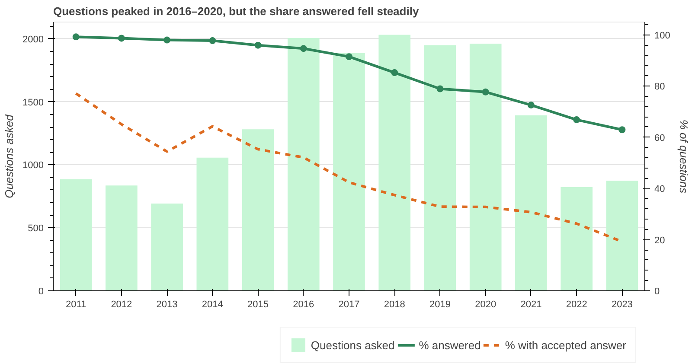
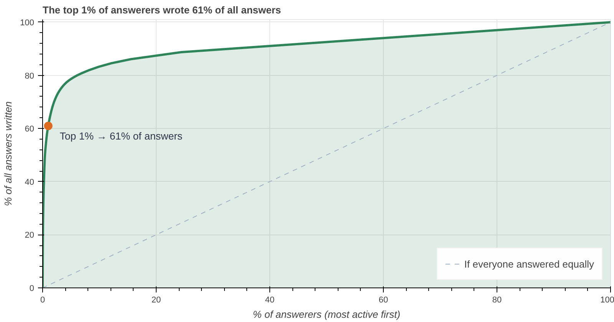
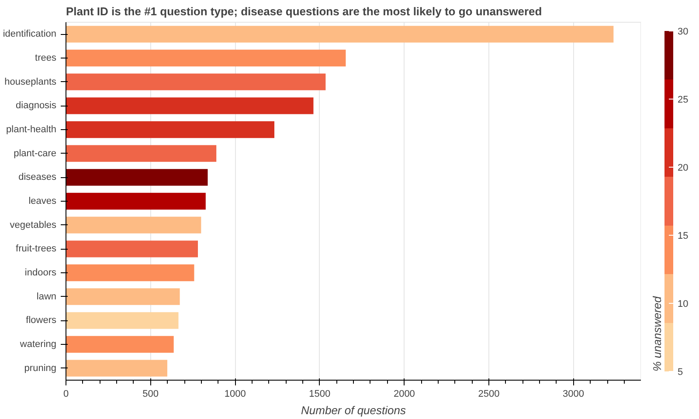
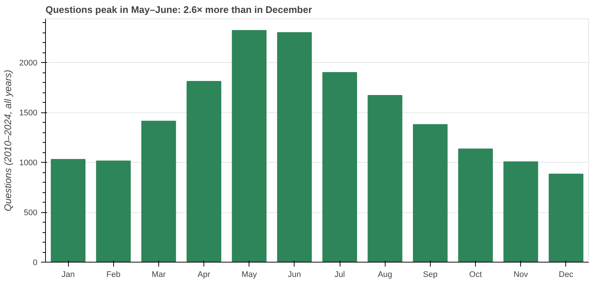
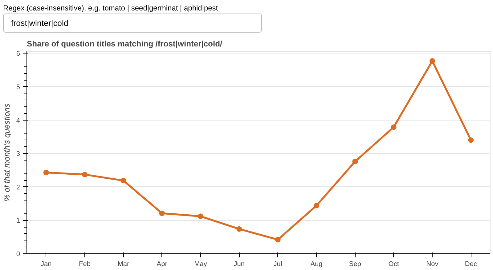
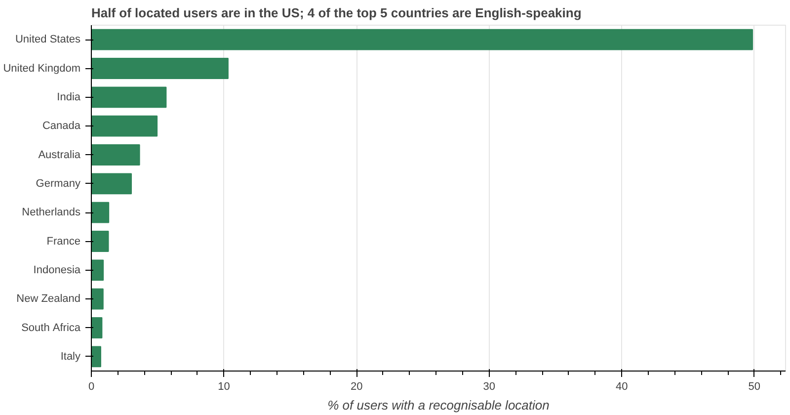

# What Do Gardeners Ask? Text-Mining 14 Years of Gardening Q&A

What does an online gardening community ask about, when do people ask it, and has the community kept up with answering? This project analyses **17,860 questions and 25,421 answers** from Gardening & Landscaping Stack Exchange (2010–2024), using regular expressions to pull structure out of messy text and Bokeh for interactive charts.

**Tools:** Python · pandas · regex · Bokeh · pycountry · Jupyter

📓 **[View the full notebook with interactive charts (nbviewer)](https://nbviewer.org/github/tinak25/data-analysis-projects/blob/main/gardening-qa-analysis/gardening_qa_analysis.ipynb)**

## Key findings

| | Finding |
|---|---|
| 📉 | **The answer rate fell from 99% (2011) to 63% (2023).** Accepted answers fell from 77% to 19%, and the median wait for a first answer roughly tripled. |
| 👥 | **The community runs on a few experts:** the top 1% of answerers wrote 61% of all answers, and just 10 people wrote 42%. |
| 🌿 | **"What is this plant?" is the #1 question** (18% of all questions). **Disease and diagnosis questions** go unanswered most often (22–28% vs ~14% overall). |
| 📅 | **Questions follow the growing season:** May–June has 2.6× the volume of December, and "frost/winter/cold" questions are 14× more common in November than in July. |
| 🌍 | **Half of users with a location are in the US.** 4 of the top 5 countries are English-speaking. |
| 📷 | Photo questions *look* less likely to be answered, but within the same year they do slightly better (+1.5 pts). The raw comparison is confounded by time. |

## Charts

**Question volume and answer rate by year**


**Who does the answering?** Cumulative share of answers by the most active answerers


**Top topics, coloured by % unanswered** (tags extracted with regex)


**Questions by calendar month**


**Seasonal keyword explorer**: in the notebook, type any regex and the chart updates in the browser


**Where users are from**: free-text locations parsed to countries with regex + pycountry


## Data & method

**Source:** [Stack Exchange Data Dump](https://archive.org/details/stackexchange), `gardening.stackexchange.com` (data to March 2024), licensed [CC BY-SA 4.0](https://creativecommons.org/licenses/by-sa/4.0/). Two tables are used: `Posts` (questions and answers) and `Users`.

**Wrangling steps**
1. Converted the XML dump files (`<row ... />` elements) to CSV.
2. Split `Posts` into questions and answers by `PostTypeId` before cleaning. Answers have no title, so dropping rows with a missing title would delete them all.
3. Linked each answer to its question (`ParentId`) to get time to first answer, answered and accepted flags.
4. Used regex to extract tags from `|tag1|tag2|` strings, detect embedded photos (`<img`), parse free-text locations into countries, and power a live keyword search.
5. Checked the photo effect within years to avoid a confounded comparison.

**Ethics:** no usernames, user IDs or individual locations are shown, only aggregates. Some users typed street addresses into their location field, so locations are reduced to country level and never displayed raw.

**Limitations:** English-language, single-site data. Only ~32% of users give a location. The regex matching is approximate (e.g. "cold frame" matches "cold").

## Run it yourself

1. Download `gardening.stackexchange.com.7z` from the [Stack Exchange Data Dump](https://archive.org/details/stackexchange) and extract `Posts.xml` and `Users.xml` into `data/raw/`.
2. Run:
```bash
pip install -r requirements.txt
jupyter notebook gardening_qa_analysis.ipynb
```
The notebook converts the XML to CSV on first run.

## Structure
```
gardening-qa-analysis/
├── gardening_qa_analysis.ipynb   # full analysis, run with outputs
├── images/                       # chart snapshots for this README
├── data/raw/                     # (not committed) dump files go here
└── requirements.txt
```
