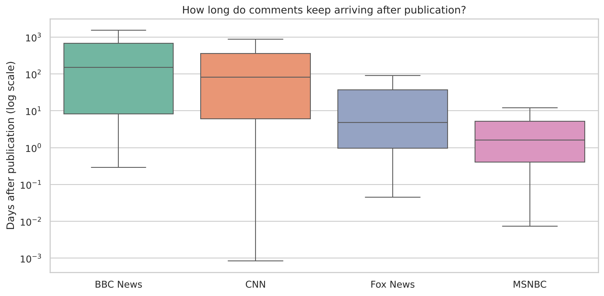

# YouTube COVID-19 News Engagement Analysis

Analysis of how audiences engaged with COVID-19 coverage from four English-language news publishers on YouTube: **BBC News, CNN, Fox News and MSNBC**.



## Question

How did audience engagement with COVID-19 news differ across publishers, in reach, engagement quality, and how quickly viewers responded?

## Data

- **~200 videos** (about 50 per channel) and **~4,400 comments**
- Collected with the **YouTube Data API v3**, searching video titles for `coronavirus`, `covid`, `covid-19` and `pandemic`
- Videos published between Jan 2020 and Jan 2023

See [`data/README.md`](data/README.md) for the schema and how the data was collected.

## Approach

1. Cleaned and parsed timestamps (UTC) and ISO 8601 video durations
2. Compared total and per-video views, likes and comments by channel
3. Ranked videos by likes per view to find the most strongly received content
4. Measured comment response time (days from publish to comment) by channel
5. Compared weekly publishing cadence

## Key findings

| Finding | Detail |
|---|---|
| CNN dominates reach | 47% of total views and 52% of comments; median ~316k views per video vs ~212k for BBC |
| Fox News has the most engaged audience | Median 1.59 likes per 100 views, about double BBC (0.78) and CNN (0.85); 4 of the top 5 videos by like rate are Fox |
| Two comment lifespans | Commenting on MSNBC (median ~1.6 days) and Fox News (~4.9 days) videos fades within days; BBC (~150 days) and CNN (~82 days) videos were still drawing comments months later |
| Long-tail discovery | BBC and CNN COVID videos appear to be found long after release, likely via search and recommendations |


## Limitations

- About 50 videos per channel from ranked keyword search, so this isn't a random sample
- Only the newest ~20 comment threads per video were collected, so timing reflects comment lifespan, not typical response speed
- Comment text was pre-processed (lowercased, stopwords removed) during collection
- Engagement counts are a snapshot at collection time

## Tech stack

Python, pandas, NumPy, Matplotlib, seaborn, YouTube Data API v3, Jupyter

## Run it

```bash
pip install -r requirements.txt
jupyter notebook youtube_news_analysis.ipynb
```

## Project structure

```
├── data/                  # videos.csv, comments.csv
├── images/                # charts used in this README
├── youtube_news_analysis.ipynb
├── requirements.txt
└── README.md
```

---
Originally built for SIT112 Data Science Concepts at Deakin University, then extended and restructured.
